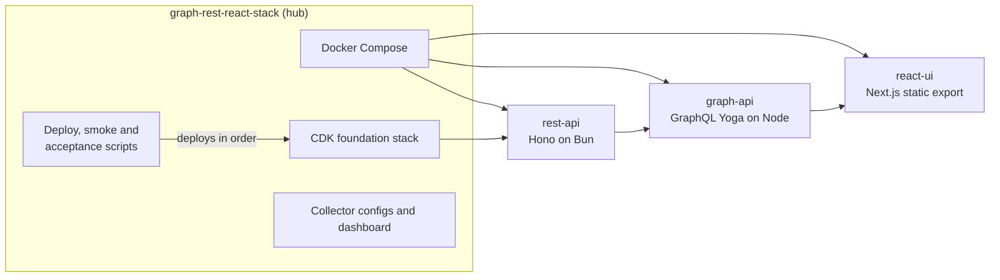
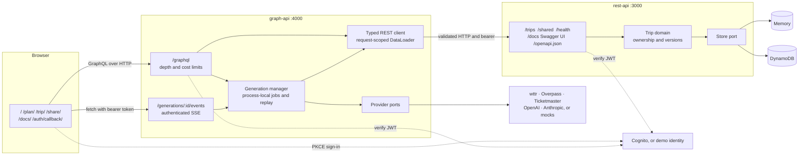
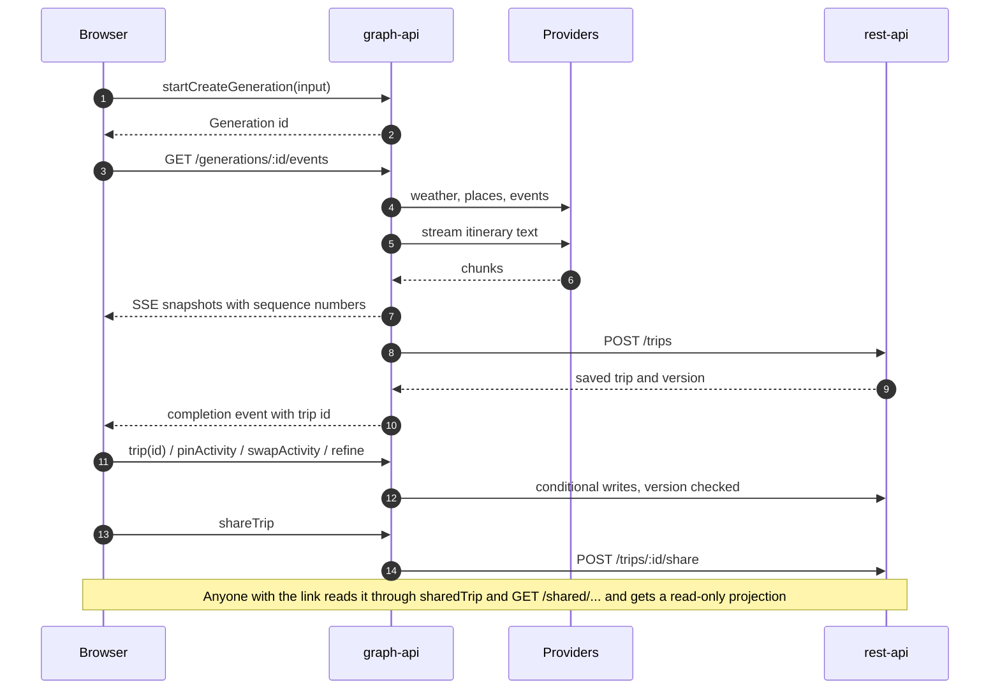
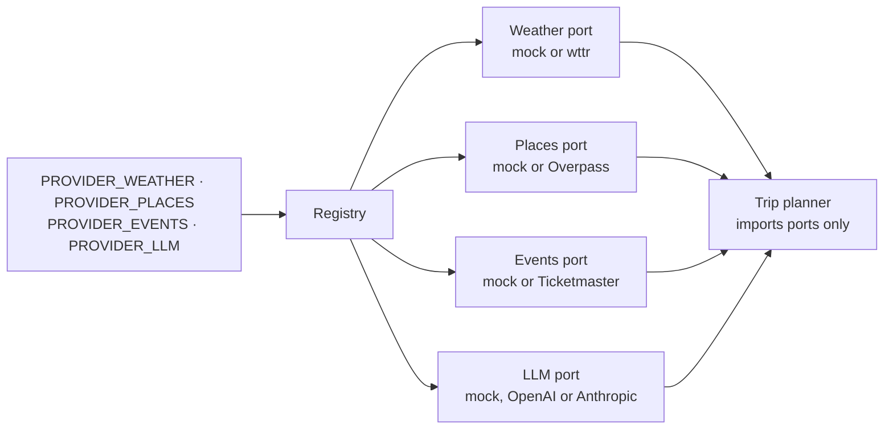
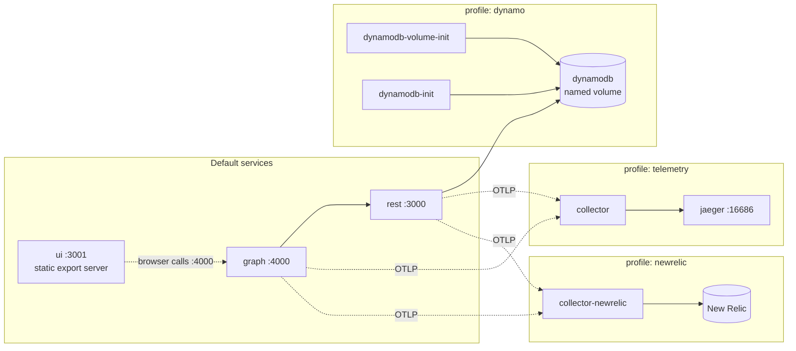
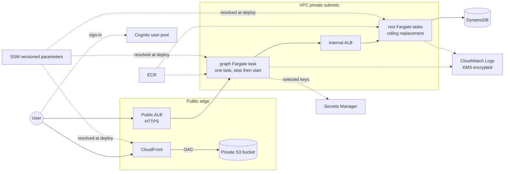
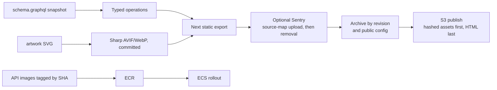

# Architecture

Wander is a trip planner split into three applications and one hub. They talk to each other only
through typed interfaces. The browser talks to GraphQL, GraphQL talks to REST, and only REST
stores data.

## Repositories

Each repository installs, tests and deploys on its own. The hub pins compatible revisions and
owns everything the three applications share.

| Layer   | Owns                                                                                | Main trade-off                                              |
| ------- | ----------------------------------------------------------------------------------- | ----------------------------------------------------------- |
| UI      | Interaction, generated urql operations, PKCE sign-in, planning guides, local images | Public configuration is fixed at build time                 |
| GraphQL | Client-shaped reads, DataLoader, provider orchestration, generation lifecycle       | Process-local jobs need one task; a restart interrupts work |
| REST    | Domain rules, ownership, conditional writes, share projections, OpenAPI             | The extra HTTP hop keeps persistence separate from planning |
| Hub     | Compose, shared CDK foundation, release tooling                                     | Four independent repositories need compatible revisions     |

## Runtime

By default the system runs on mock providers, demo identity and in-memory storage, with
telemetry off. A fresh clone needs no accounts. In live mode, both APIs verify Cognito access
tokens and never fall back to demo identity. Memory storage resets when REST restarts. DynamoDB
keeps trips but not graph jobs.

## Planning journey

If the connection drops, the browser reconnects and replays from the last sequence number it
saw. A stale edit gets a conflict back instead of overwriting newer data. A share stays readable
until it expires or is revoked; revoking is the REST `DELETE /trips/:id/share` call.

## Planning providers

Only the adapters you select get built. A selected adapter must have its key and model before
startup, and if it fails at runtime it reports a safe error rather than quietly switching to a
mock.

## Local container stack

Source development and Compose use the same ports, so run only one at a time. A normal shutdown
keeps the database volume.

## AWS

The foundation stack owns the shared, stateful pieces: the network, both load balancers, the
cluster, the table, Cognito, the image repositories, the bucket, the log key and the roles. It
publishes all of them as versioned SSM parameters. Each application stack resolves those
parameters at deploy time and deploys only its own compute or distribution. REST and the tasks are never publicly
reachable, and the UI stack owns the bucket's only access policy.

## Build and release

Next builds the static app, Vite only transforms tests, and Sharp runs at build time.
There is no Next server running at request time and no direct path from the UI to REST.
Rollback republishes an archived export without rebuilding it. Hashed assets are kept between
releases, but a release is not atomic across pages.

## Observability and testing

API telemetry uses OpenTelemetry for traces, metrics and redacted logs, and is off by default.
When turned on it goes to a collector that forwards to Jaeger or New Relic. W3C trace context
carries from the browser through graph to REST. Browser errors go to Sentry, also opt-in.
Vitest, real REST-to-graph integration tests, Playwright and CDK assertions cover the boundaries
locally. Docker acceptance and account-backed acceptance run separately.
